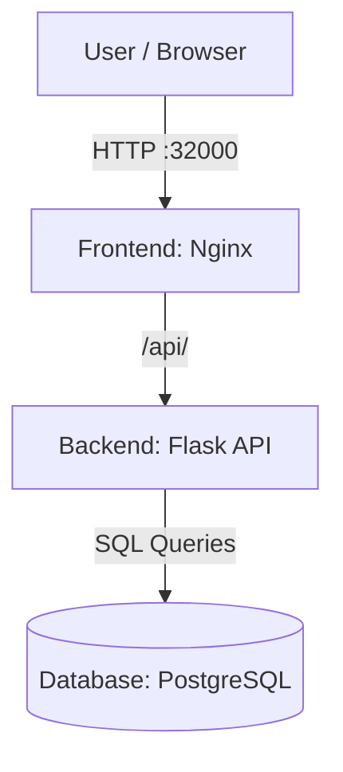
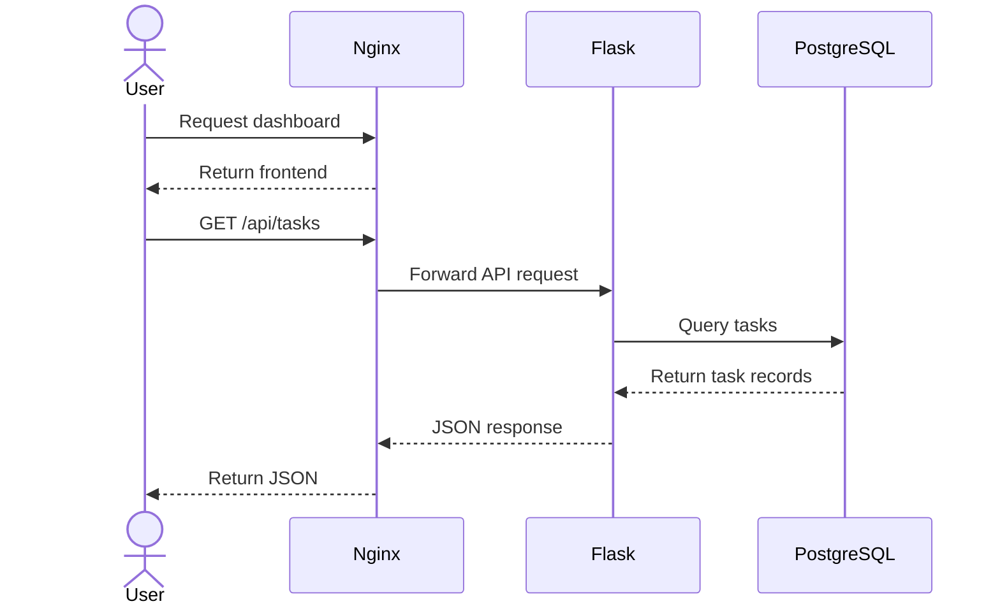
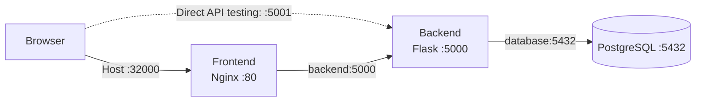
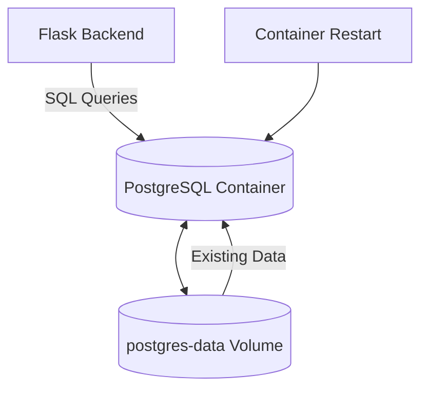

# 🐳 Dockerized Three-Tier Application

A containerized web application built using **Docker, Nginx, Flask, PostgreSQL, and Docker Compose**. This project demonstrates a three-tier architecture with separate frontend, backend, and database services.

## 🏗️ Architecture



## 🛠️ Technology Stack

| Technology | Purpose |
|---|---|
| Docker | Containerization |
| Docker Compose | Multi-container orchestration |
| Nginx | Web server and reverse proxy |
| HTML, CSS, JavaScript | Frontend interface |
| Python | Backend programming |
| Flask | REST API |
| Gunicorn | Python application server |
| PostgreSQL | Relational database |
| Git & GitHub | Version control |

## ✨ Features

- Three-tier application architecture.
- Separate frontend, backend, and database containers.
- Nginx reverse proxy for API requests.
- Flask REST API connected to PostgreSQL.
- Docker Compose service orchestration.
- Container health checks.
- Persistent database storage using Docker volumes.
- Environment-based database configuration.
- Dedicated Docker bridge network.

## 📁 Project Structure

```text
docker-3-tier-app/
├── frontend/
│   ├── Dockerfile
│   ├── index.html
│   └── nginx.conf
├── backend/
│   ├── Dockerfile
│   ├── app.py
│   └── requirements.txt
├── database/
│   └── init.sql
├── docker-compose.yml
├── .env.example
├── .gitignore
└── README.md
```

## 🚀 Getting Started

### Prerequisites

- Linux or another supported operating system
- Docker Engine
- Docker Compose
- Git

### 1. Clone the Repository

```bash
git clone https://github.com/talha-zahoor-isra/docker-3-tier-app.git
cd docker-3-tier-app
```

### 2. Configure Environment Variables

Create your local environment file:

```bash
cp .env.example .env
```

Open the file:

```bash
nano .env
```

Set a strong database password:

```dotenv
DB_PASSWORD=your_strong_password
```

Save the file and restrict its permissions on Linux:

```bash
chmod 600 .env
```

**Security:** Never upload your `.env` file or real credentials to GitHub.

### 3. Build and Start the Application

```bash
docker compose up --build -d
```

### 4. Check Container Status

```bash
docker compose ps
```

### 5. Access the Application

Open the frontend in your browser:

**http://localhost:32000**

Check the backend health endpoint:

```bash
curl http://localhost:5001/health
```

Retrieve tasks directly from the backend:

```bash
curl http://localhost:5001/api/tasks
```

Retrieve tasks through the Nginx reverse proxy:

```bash
curl http://localhost:32000/api/tasks
```

## 🔄 How the Application Works



### Request Flow

1. The browser requests the frontend from Nginx.
2. Nginx serves the HTML, CSS, and JavaScript.
3. The frontend requests task data through `/api/tasks`.
4. Nginx forwards the request to the Flask backend.
5. Flask queries PostgreSQL.
6. PostgreSQL returns the task records.
7. Flask returns JSON through Nginx to the browser.

## 🔌 API Endpoints

| Method | Endpoint | Description |
|---|---|---|
| GET | `/` | API status |
| GET | `/health` | Backend health check |
| GET | `/api/tasks` | Retrieve tasks from PostgreSQL |

### Example API Response

```json
[
  {
    "completed": false,
    "id": 1,
    "title": "Learn Docker"
  },
  {
    "completed": false,
    "id": 2,
    "title": "Build 3-Tier Application"
  },
  {
    "completed": false,
    "id": 3,
    "title": "Deploy on Docker Hub"
  }
]
```

## 🌐 Docker Networking



The services communicate over a dedicated Docker bridge network.

| Service | Host Port | Container Port |
|---|---:|---:|
| Frontend | 32000 | 80 |
| Backend | 5001 | 5000 |
| PostgreSQL | 5433 | 5432 |

PostgreSQL's host port is bound to `127.0.0.1`, limiting host-side access to the local machine.

## 💾 Database Persistence

PostgreSQL uses a named Docker volume to preserve database files independently of the container lifecycle.



The database volume normally survives container restarts and recreation.

**Warning:** The command `docker compose down -v` removes the Compose-managed database volume and its stored data. Use it only when you intentionally want to reset the database.

## 🐳 Useful Docker Commands

### View Running Services

```bash
docker compose ps
```

### View Application Logs

```bash
docker compose logs -f
```

### View Backend Logs

```bash
docker compose logs -f backend
```

### Restart Services

```bash
docker compose restart
```

### Rebuild and Start

```bash
docker compose up --build -d
```

### Stop the Application

```bash
docker compose down
```

## 🔐 Security Practices

- Database credentials are stored in `.env`.
- The `.env` file is excluded from Git.
- `.env.example` provides a configuration template.
- PostgreSQL's host port is bound to localhost.
- Application services communicate over a dedicated Docker network.

For production deployments, consider HTTPS, secrets management, database backups, monitoring, vulnerability scanning, and restricting unnecessary public ports.

## 📸 Screenshots

Screenshots of the running application, Docker containers, and API responses will be added here later.

## 🛣️ Future Improvements

- [ ] Publish frontend and backend images to Docker Hub.
- [ ] Implement additional task-management API operations.
- [ ] Add automated API tests.
- [ ] Create a CI/CD pipeline using GitHub Actions.
- [ ] Add container image vulnerability scanning.
- [ ] Deploy the application on AWS.
- [ ] Configure HTTPS and production monitoring.
- [ ] Add application screenshots.

These are planned improvements, not features claimed to be already implemented.

## 👨‍💻 Author

**Talha Zahoor**

GitHub: [@talha-zahoor-isra](https://github.com/talha-zahoor-isra)

Project Repository: [docker-3-tier-app](https://github.com/talha-zahoor-isra/docker-3-tier-app)

---

⭐ Built as a hands-on project to practice Docker, Linux, networking, API integration, database connectivity, and DevOps fundamentals.
